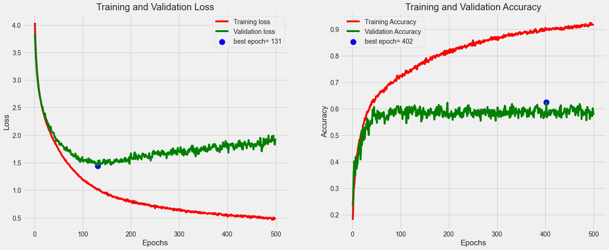
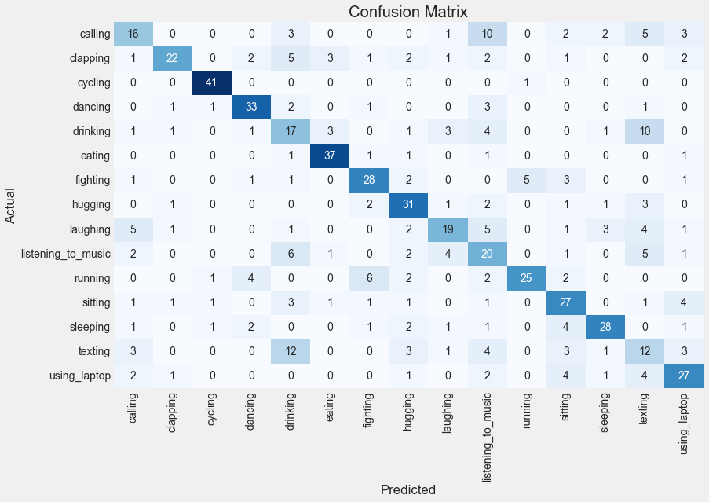

# Human Action Recognition: CNN boosted with EfficientNetB0

My MSc Big Data Analytics dissertation at Edge Hill University (2022): classifying still images into 15 human actions, comparing a custom CNN with the same CNN boosted by a pre-trained EfficientNetB0 branch.

## Result

Adding the EfficientNetB0 branch lifted test accuracy from **54.29% to 60.79%** at 500 epochs (630 test images, 42 per class).

| Epochs | Base CNN | EfficientNetB0-boosted |
|---|---|---|
| 100 | 35.71% | 49.05% |
| 250 | 32.22% | 52.38% |
| 500 | 54.29% | **60.79%** |
| 1,000 | run crashed | 54.29% |

At 500 epochs the boosted model's best class was cycling (F1 0.94) and its worst was texting (F1 0.28). Most confusion was between similar-looking actions: drinking vs texting, and listening to music vs calling. Both models overfit: the boosted model reached 91.8% training accuracy against 57.6% validation.

## Data

- Kaggle Human Action Recognition dataset: 15 balanced classes, 12,600 labelled images.
- Only the labelled training CSV is used, split stratified 90/5/5 (11,340 / 630 / 630, `random_state=123`). The supplied test CSV isn't used.
- Training was capped at 400 images per class (6,000 images) to fit a 3 GB GPU.
- Images aren't in this repo. The script expects the dataset under `../Artefact/Dataset 1/Human Action Recognition/`; edit the paths near the top of the script to match your copy.

## Method

- Input 200 × 200, batch size 32, Adam (learning rate 0.0001), categorical cross-entropy.
- Base CNN: two Conv2D(16) layers, separable-convolution blocks (32 → 256) with dropout, then dense layers (512 → 64, L2 0.001) and a 15-way softmax.
- Boosted: EfficientNetB0 (ImageNet weights, frozen, no top), flattened to Dense(15), concatenated with the base CNN's output, then a final 15-way softmax.
- Accuracy is computed as 1 − errors / tests. The logs' "there were N in 630 tests" counts errors.

## Files

| Path | What it is |
|---|---|
| `har-classifier-base-model-efficientnetb0-boosted.py` | Boosted model; its base branch is the base CNN |
| `report/burrell_23893036.docx` | The dissertation |
| `report/Results - Base Model.docx` | Training logs and classification reports, base model |
| `report/Results - EFFICIENTNETB0 Boosted.docx` | Training logs and classification reports, boosted model |
| `figures/` | Loss/accuracy curves and confusion matrices for every run |

**Requirements:** Python 3, TensorFlow/Keras, scikit-learn, pandas, NumPy, Matplotlib, Seaborn.

## Known issues

- **Base model script not included.** The standalone base-model script was edited after submission (2023) and no longer matches the base CNN the dissertation describes, so it's left out. The base CNN is the base branch of the boosted script, which is set to 500 epochs; change `epochs` to reproduce the other runs.
- **Overfitting.** Training accuracy runs far ahead of validation in every run, and the boosted model got worse from 500 to 1,000 epochs. The dissertation calls the result "average" and not ready for practical use.
- **Test set.** The 630-image test set is a held-out slice of the labelled training data, not an independent test set.
